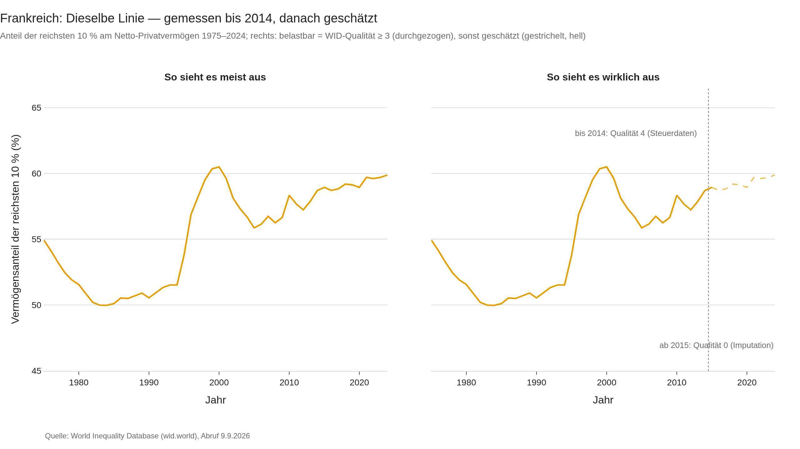
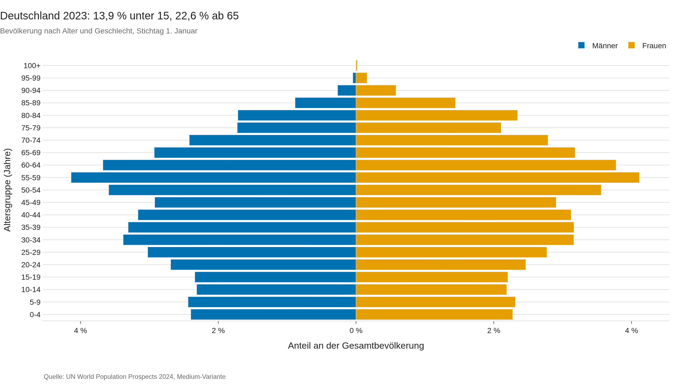
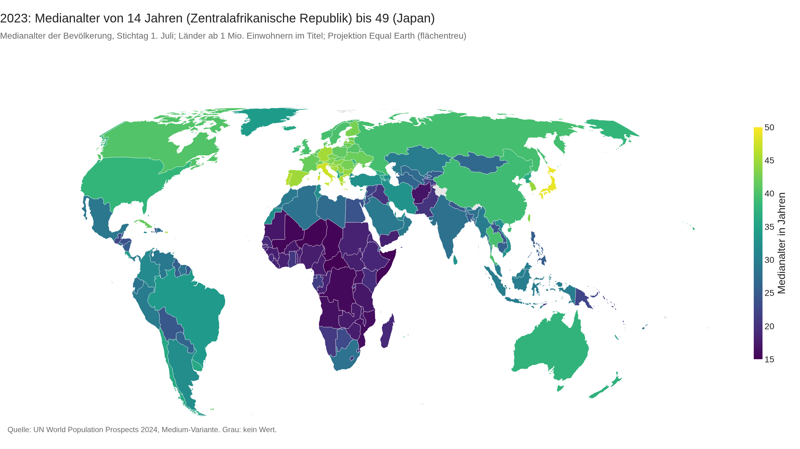
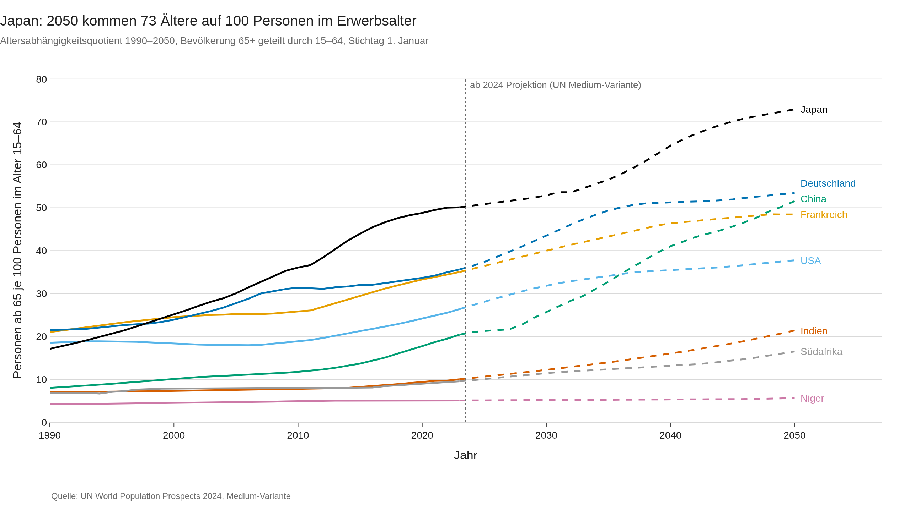
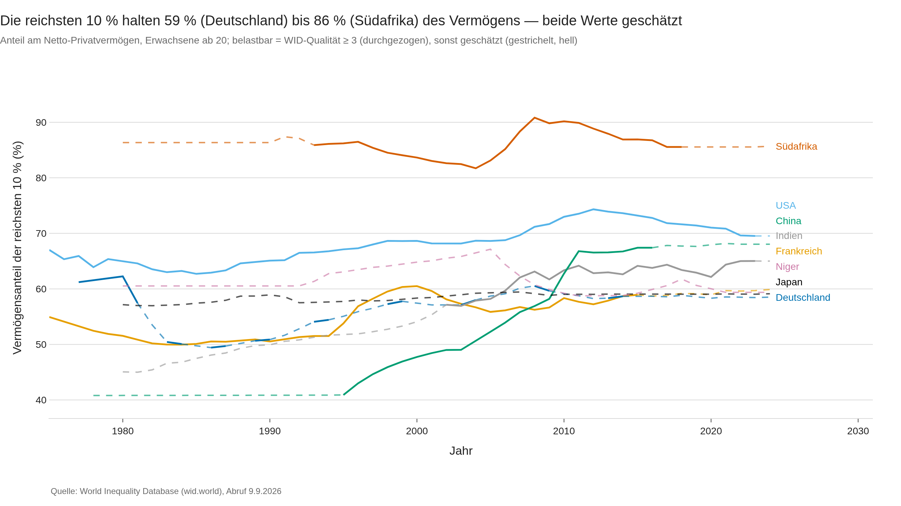
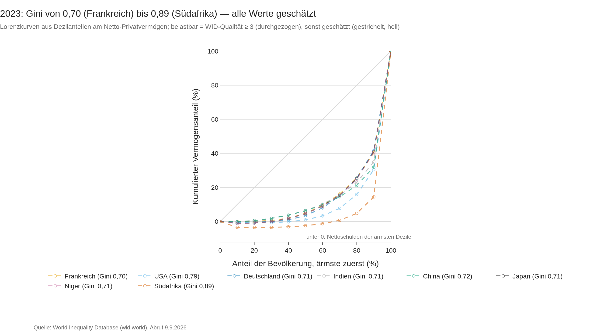
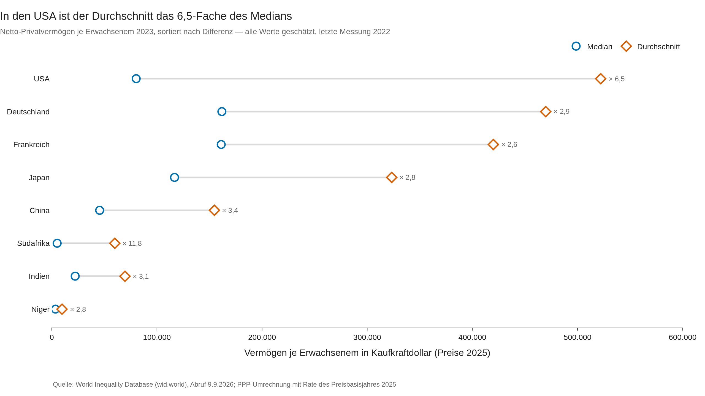
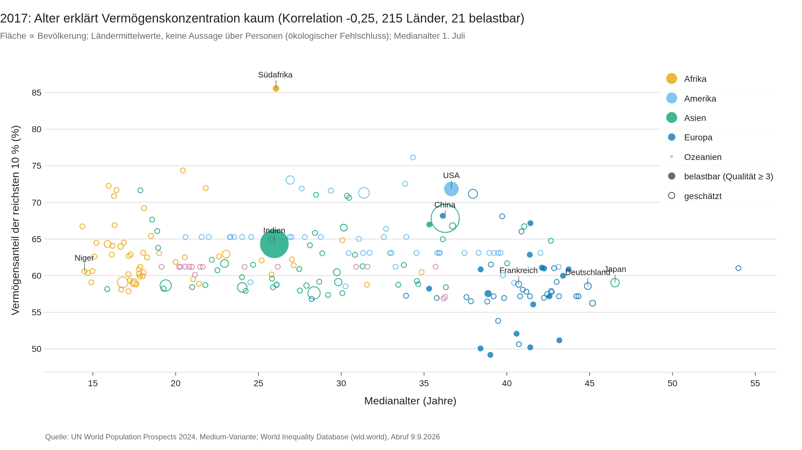
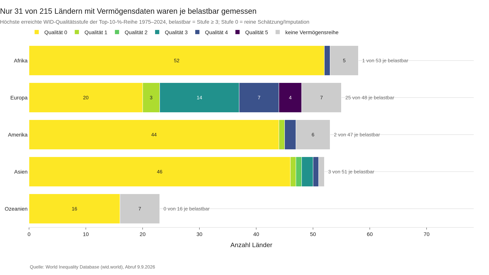

# Alter und Vermögen international

**Wie verteilen sich Alter und Vermögen international — und was wissen wir
davon wirklich?**

Interaktives Dashboard (Streamlit + Plotly) und zehn statische Grafiken zu
Altersstruktur und Vermögensverteilung weltweit. Entstanden als
Prüfungsleistung im Bachelor-Wahlmodul „Datenvisualisierung, Infografik und
Data Storytelling".

Der Kernbefund: Die beiden Hälften des Themas sind sehr unterschiedlich
belastbar. **Alter** ist für alle Länder gemessen und harmonisiert (UN).
**Vermögen** ist für fast alle Länder *geschätzt* — die World Inequality
Database liefert zwar für 215 Länder lückenlose Reihen, aber nur 31 davon
waren je belastbar gemessen. Das Dashboard zeigt deshalb nicht nur
Verteilungen, sondern macht die Datenqualität in jedem Vermögens-Chart
sichtbar.



## Aufbau

Das Dashboard folgt einer Dramaturgie in vier Tabs:

| Tab | Frage | Charts |
|---|---|---|
| 1 · Demografie | Die Welt altert — sehr ungleich | C1 Bevölkerungspyramide, C2 Pyramiden-Vergleich, C3 Medianalter-Karte, C4 Altenquotient 1990–2050 |
| 2 · Vermögen | Vermögen ist ungleicher verteilt als Alter | C5 Top-10-%-Anteil im Zeitverlauf, C6 Lorenzkurven, C7 Median vs. Mittelwert |
| 3 · Zusammenhang | Konzentriert sich Vermögen in alten Gesellschaften? | C8 Medianalter × Top-10-% |
| 4 · Datenqualität & Methodik | Wie viel davon ist gemessen? | C9 Qualität je Region, C10 Der Bruch in Frankreich, Quellen, Limitationen |

In der Sidebar: Länderauswahl, Jahr und der Schalter **„nur belastbare Werte
(Qualität ≥ 3)"**, der in allen Vermögens-Charts wirkt.

## Grafiken

| | |
|---|---|
|  |  |
|  |  |
|  |  |
|  |  |

Alle Grafiken liegen in [`figures/`](figures/) als PNG (2560 × 1440) und SVG.

## Datenquellen

| Quelle | Inhalt | Bezug |
|---|---|---|
| **UN World Population Prospects 2024** (WPP), Medium-Variante | Bevölkerung nach Alter und Geschlecht, Medianalter, Fertilität, Lebenserwartung, 1950–2100 | [population.un.org/wpp](https://population.un.org/wpp/) → *Download Center* → CSV |
| **World Inequality Database** (WID), Bulk-Download, Abruf 9.9.2026 | Vermögensanteile, Durchschnitts- und Medianvermögen, Kaufkraftparitäten, Qualitätsscore je Beobachtung | [wid.world/data](https://wid.world/data/) → *Download full dataset* |

Die Rohdaten sind nicht im Repository (rund 6,5 GB). Sie unterliegen den
Nutzungsbedingungen der jeweiligen Anbieter; bei Weiterverwendung bitte dort
zitieren.

## Methodische Entscheidungen

Ausführlich in [`docs/projektspezifikation.md`](docs/projektspezifikation.md)
(Abschnitte 4 und 12), die Gestaltungsregeln in
[`docs/visualisierungsregeln.md`](docs/visualisierungsregeln.md).

**Datenqualitätsfilter.** WID vergibt je Land, Reihe und Jahr einen
Qualitätsscore von 0 bis 5; 0 heißt reine Schätzung bzw. Imputation.
*Belastbar* ist hier ein Wert mit Qualität ≥ 3 (Konstante `BELASTBAR` in
`src/load.py`). Geschätzte Abschnitte sind in allen Vermögens-Charts
gestrichelt und aufgehellt, Titel weisen auf geschätzte Extremwerte hin, und
der Sidebar-Schalter blendet sie ganz aus. Eine Grafik, die geschätzte und
gemessene Werte gleich aussehen lässt, gilt in diesem Projekt als Fehler.

**Vertiefungsländer.** Frankreich, USA, Deutschland, Indien, China, Japan,
Niger, Südafrika. Die Auswahl deckt beide Achsen ab: demografisch von sehr
jung (Niger) bis sehr alt (Japan), bei der Datenqualität von lange belastbar
(USA 1975–2022, Frankreich bis 2014) bis durchgehend geschätzt (Japan,
Niger).

**Kaufkraftparitäten.** Durchschnitts- und Medianvermögen liegen bei WID in
lokaler Währung zu konstanten Preisen vor. Für den Ländervergleich werden
sie mit **einer** PPP-Rate je Land umgerechnet, der des Preisbasisjahres
(2025); `clean.py` bricht ab, wenn PPP-Jahr und Preisbasisjahr
auseinanderfallen. Jahresspezifische Raten wären ein Einheitenfehler.
Kaufkraftdollar erscheinen nur in C7 und nur für 2023; alle Anteile, Dezile
und Lorenzkurven sind einheitenfrei.

**Weitere Festlegungen.**

- Kernvariable `shwealj992`: Anteil am Netto-Privatvermögen, Erwachsene ab
  20, Vermögen zu gleichen Teilen auf Paare verteilt. `shwealj999` (alle
  Altersgruppen) wird bewusst nicht geladen.
- Join über ISO-2-Codes, WPP ist die Basis (`how="left"`), damit Länder ohne
  Vermögensdaten sichtbar bleiben. Nicht zugeordnete Codes stehen in
  `data/processed/join_protokoll.csv`.
- Regionen einheitlich aus der WPP-Hierarchie (UN-Geoschema).
- Beobachtungen bis 2023, WPP-Projektionen 2024–2050 sind gestrichelt.
- C8 wird zusätzlich für 2017 exportiert, weil 2023 alle Vermögenswerte
  Qualität 0 haben.

**Limitationen.** Ländervergleiche sind keine Aussagen über Individuen
(ökologischer Fehlschluss). Eine PPP-Rate über fünfzig Jahre verzerrt
frühe Ländervergleiche. WID deflationiert Vermögen mit dem allgemeinen
Preisindex statt mit Vermögenspreisen. Die Projektionen sind Modellwerte.

## Ausführen

Voraussetzungen: Python 3.12 und [uv](https://docs.astral.sh/uv/).

```sh
uv sync
```

Rohdaten ablegen:

```
data/raw/wpp/WPP2024_Demographic_Indicators_Medium.csv.gz
data/raw/wpp/WPP2024_Population1JanuaryByAge5GroupSex_Medium.csv.gz
data/raw/wid/WID_countries.csv
data/raw/wid/WID_data_XX.csv          (eine Datei je Land/Region)
data/raw/wid/WID_metadata_XX.csv
```

Dann:

```sh
uv run python -m src.clean                 # Rohdaten → data/processed/*.parquet (einmalig, dauert)
uv run streamlit run app.py                # Dashboard
uv run python scripts/export_figures.py    # Grafiken nach figures/
uv run pytest -q                           # Tests
```

Der Export braucht über `kaleido` einen Chromium-Browser. Ist kein Chrome
oder Chromium im `PATH`, aber Flatpak vorhanden, nutzt das Skript
`scripts/kaleido-browser.sh` (Brave als Flatpak). Ein anderer Browser lässt
sich über die Umgebungsvariable `BROWSER_PATH` setzen.

## Projektstruktur

```
app.py                     Streamlit-Dashboard
src/load.py                Rohdaten einlesen, projektweite Konstanten
src/clean.py               Aufbereitung und Join → data/processed/
src/abdeckung.py           Auswertung der Datenqualität je Land
src/charts.py              Charts C1–C10, je eine Funktion
scripts/export_figures.py  statischer Export nach figures/
tests/                     pytest, inkl. Headless-Test der App
docs/                      Spezifikation und Visualisierungsregeln
```

## Lizenz

Code unter der [MIT-Lizenz](LICENSE). Die Daten gehören den jeweiligen
Anbietern (UN DESA, World Inequality Lab).
